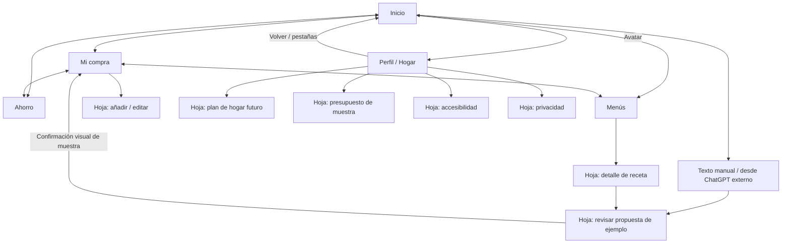

# B02 · Pantallas, navegación y componentes

**Estado: propuesta UX para revisión.** Dirección elegida: **V3 Verde Mercado**. **M3 es provisional**; el refinamiento del logo queda para más adelante y no bloquea las pantallas. B02 diseña la experiencia; no autoriza lógica de negocio, backend, cuentas, IA, comercio ni el comienzo de B03.

## Qué representa esta entrega

El material visual de `design/b02/` es un prototipo aislado de presentación, con navegación y estados de muestra. La aplicación anterior y B01 se conservan. Se distinguen tres niveles:

| Nivel | Significado en B02 |
|---|---|
| Maqueta | Pantalla o estado con contenido controlado para revisar jerarquía, textos y disposición. |
| Prototipo de presentación | Permite explorar vistas, hojas y confirmaciones de ejemplo. La interacción no demuestra guardado, interpretación de texto, precios reales o sincronización. |
| Función real de producto | Debe implementarse y probarse en su bloque posterior. No se declara terminada por aparecer en una captura. |

El contenido de referencia es un presupuesto de **60 €**, seis productos y dos marcados como ejemplo. No se atribuye ningún precio comercial a esos productos. El presupuesto es un límite elegido de muestra, no el gasto ni una estimación del total. Las búsquedas con ChatGPT continúan **fuera de la app**; no existe una conexión ni una llamada a IA en este prototipo.

## Navegación y responsabilidad de cada vista

Cuatro pestañas persistentes: **Inicio, Mi compra, Ahorro y Menús**. El avatar superior conduce a **Perfil/Hogar**. Mi compra es la única lista; no se duplica un módulo «Lista». El estado activo se comunica con icono, etiqueta y señal visual.

| Vista / ruta | Trabajo principal | Acción principal | Contenido que debe entenderse |
|---|---|---|---|
| Inicio / `home` | Empezar o retomar la compra. | Crear o continuar Mi compra. | Entrada manual, resumen presupuestario, artículos sin precio y acceso al contexto semanal. |
| Mi compra / `list` | Revisar artículos en supermercado. | Añadir producto. | Cantidad, unidad, pendientes/comprados y estado de precio; acción alcanzable y navegación visible. |
| Ahorro / `savings` | Comprender qué se sabe del coste. | Volver a Mi compra cuando falten datos. | Total parcial o pendiente, fuente/fecha cuando existan y ausencia de comparaciones válidas. |
| Menús / `menus` | Elegir un plato y revisar ingredientes. | Abrir receta o revisar ingredientes. | Personas, tiempo, ingredientes y revisión previa; sin coste por ración no sustentado. |
| Perfil/Hogar / `profile` | Entender modo local y preferencias. | Acceder al ajuste o explicación elegidos. | Cuenta no obligatoria, privacidad y plan futuro de hogar; sin invitación ni sincronización operativas. |

Las hojas se pueden cerrar o cancelar. Volver debe recuperar la vista de origen. Una confirmación del prototipo se identifica como tal; no registra una compra ni altera la aplicación anterior.

## Flujos anotados F1–F5

| Flujo | Secuencia propuesta | Revisión y salida | Límite actual |
|---|---|---|---|
| **F1 · Primera compra** | Inicio vacío → Crear mi lista → Mi compra vacía → Añadir → revisar nombre, cantidad y unidad → ver lista de muestra. | Cerrar/cancelar la hoja; editar antes de confirmar; estado de marcado y deshacer diseñados. | Sin registro obligatorio en el diseño. La persistencia de 10+ artículos, cierre/reapertura y uso offline real son aceptación de **B04**, no un resultado de B02. |
| **F2 · Menú a lista** | Menús → receta → ingredientes → revisión de coincidencias, unidades y raciones → confirmación visual → Mi compra. | Corregir cantidades, excluir ingredientes o cancelar toda la propuesta. No añadir automáticamente al abrir una receta. | Recetas y elementos controlados de demostración; sin generador ni deduplicación de negocio. |
| **F3 · Entrada de texto** | Inicio → escribir o pegar una lista preparada fuera de la app → revisión de ejemplo → corregir o cancelar → confirmación visual. | El texto original y los elementos propuestos deben distinguirse. Nada se añade silenciosamente. | ChatGPT se usa externamente. La pantalla de revisión no demuestra un parser ni una interpretación de IA. Voz/IA futuras requieren su propia decisión y bloque. |
| **F4 · Comparación sin datos** | Mi compra → Ahorro → reconocer artículos sin precio → consultar explicación → continuar con la lista para comprar presencialmente. | Volver a la lista sin seleccionar una tienda ni conceder permisos. | No se consulta catálogo, stock o precios. Sin fuente válida no se calcula ahorro ni un total de cesta aparentemente completo. |
| **F5 · Compartir hogar** | Perfil/Hogar → explicación de uso compartido → revisar futura invitación, revocación y privacidad → volver. | Cerrar sin crear cuenta ni compartir datos. | **Solo plan visual.** Invitaciones, autenticación, sincronización y permisos entre hogares pertenecen a B07. |

## Estados críticos y respuesta visual

Los nombres siguientes son estados de presentación para reproducir capturas, no errores o condiciones de red observados en producción.

| Estado | Vista de referencia | Mensaje y comportamiento esperado |
|---|---|---|
| `empty` | Mi compra | Explicar el primer paso y mostrar Añadir; no llenar la pantalla con números de gasto ficticios. |
| `loading` | Inicio | Identificar carga, conservar orientación y ofrecer salida del estado de muestra; no presentar datos pendientes como reales. |
| `offline` | Mi compra | Aviso que no tape la lista ni la acción manual. El diseño de uso local permanece accesible. |
| `mic-denied` | Inicio | Permiso denegado con explicación breve y alternativa por texto. Sin insistir en permisos ni abrir un diálogo real del sistema. |
| `error` | Mi compra | Error concreto, reintento y acceso a los datos de muestra; no comunicar que una escritura ha funcionado. |
| `long-list` | Mi compra | Lista de 20+ elementos, categorías, nombres largos y acción fija; mostrar que se puede recorrer hasta el final. |
| `no-price` | Ahorro | «Sin datos suficientes» y artículos sin precio. El presupuesto sigue separado del total pendiente. |
| `over-budget` | Mi compra | Límite y exceso de ejemplo identificados, con texto y acción útil; no impedir editar o seguir con la lista. |
| `stale-price` | Ahorro | Observación antigua de muestra con fecha, procedencia y advertencia; no etiquetarla como precio actual. |
| `incomparable` | Ahorro | Explicar formatos/unidades no equivalentes y abstenerse de declarar una oferta ganadora. |

## Especificación de componentes reutilizables

| Componente | Datos y contenido | Interacciones / estados |
|---|---|---|
| Cabecera y navegación | Marca M3 provisional, nombre de vista, avatar y cuatro pestañas. | Estado seleccionado explícito; acceso a Perfil y salida de vistas secundarias. |
| Entrada rápida | Etiqueta, texto de ejemplo y acción de texto/voz distinguibles. | Foco, vacío, revisión y permiso de micro denegado; siempre alternativa manual. |
| Botón principal / secundario | Verbo concreto, icono auxiliar y etiqueta completa. | Pulsado, deshabilitado explicado y carga; objetivo táctil mínimo 44×44, principal de aproximadamente 54 de alto. |
| Fila de producto | Nombre, cantidad, unidad, nota opcional, marcado y estado del precio. | Editar, marcar/desmarcar y eliminar con salida/deshacer propuestos. El color no es el único indicador. |
| Selector de cantidades | Valor legible, unidad separada y acciones de aumentar/disminuir. | Controles con etiqueta accesible y límites explicados; el ejemplo no implica una conversión automática de unidades. |
| Resumen de presupuesto | Presupuesto, importe conocido, estimación si existe y número de artículos sin precio. | Mostrar incompleto o excedido; no tratar el límite como gasto. Estado de muestra siempre identificado. |
| Aviso de precio / fuente | Tienda, formato, unidad, fecha, procedencia y condición del dato. | Desconocido, aportado, antiguo, demo o no comparable; ninguna confianza implícita. |
| Revisión de propuesta | Origen de la propuesta, artículos, cantidades, unidades y posibles coincidencias. | Corregir, excluir, cancelar y confirmar explícitamente; sin cambios silenciosos. |
| Aviso y deshacer | Resultado de la acción de ejemplo y objeto afectado. | Acción de deshacer accesible y no tapada por navegación; semántica real a implementar después. |
| Hoja / diálogo | Título, explicación y acción de cierre. | Cancelación disponible, foco ordenado, contenido desplazable y espacio para teclado. |

### Lenguaje de datos monetarios

- **Presupuesto:** límite decidido por la persona; no se suma como un coste.
- **Precio introducido:** aportación manual que debe identificar procedencia y fecha cuando se utilice para comparar.
- **Estimación:** importe orientativo identificado; separado de gasto conocido y de un precio verificado.
- **Sin precio:** dato ausente. Se muestra así; nunca como 0 € ni como «gratis».
- **Demostración:** todo importe ficticio de una maqueta, incluido el presupuesto de 60 €, lleva contexto de ejemplo. Una observación antigua ficticia no es evidencia comercial.
- **Total parcial:** incluye solo importes disponibles y muestra los artículos excluidos. No afirmar un ahorro real o comparabilidad si faltan formatos, cantidades o fuentes.

## Composición y condiciones de uso

V3 conserva verde `#167347`, crema `#FFF9EF`, acento amarillo `#F2C94C`, texto oscuro y Manrope. El amarillo se usa para contexto y presupuesto, no para fingir ofertas. M3 no se rediseña en este bloque.

Se revisan márgenes de 24, espaciado consistente y jerarquía de números, nombres y acciones. Nombres de producto a 16 y auxiliares críticos de cantidades/precio a 13–14 como referencia; no esconder información relevante en etiquetas mínimas. Las zonas seguras y el teclado requieren validación nativa posterior además de la revisión web.

La acción de añadir debe quedar cerca del pulgar sin cubrir la última fila. En texto ampliado, se permite desplazamiento y crecimiento de filas/hojas; no truncar nombres, cantidades ni mensajes para forzar una única pantalla. Contraste, orden de lectura, foco, VoiceOver/TalkBack y movimiento reducido se revisan por separado; un contraste correcto no demuestra accesibilidad completa.

## Puerta de aprobación

ChatGPT y el propietario revisan las cinco vistas, mapa F1–F5, mensajes y ocho estados críticos. El equipo registra ajustes o aprobación explícita antes de B03. B02 no convierte sus muestras en funciones reales ni cierra el logo por mostrar M3. Los resultados de captura, comandos y límites comprobados se añaden al informe de entrega por el agente principal.
